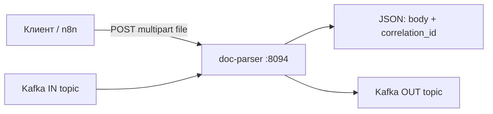

# doc-parser

Отдельный сервис: **документ → текст**. Файлы на диске не хранит — принимает во временную память, обрабатывает и удаляет.

Порт по умолчанию: **8094**. Бинарник: `cmd/docparser`. В контейнере команда `doc-parser`.

> **Не путать с parser (8091).** У основного сервиса zakupki-parser свой `POST /api/v1/extract` на порту **8091** — это другой процесс, его контракт и развёртывание не менялись. Для выделенного extract в Docker-сети используйте **doc-parser:8094**.

## Быстрый старт

### Локально

```bash
export DOC_PARSER_API_KEY='ваш-секрет'
export HTTP_ADDR=':8094'
go run ./cmd/docparser
```

### Docker (из корня репозитория)

```bash
docker build -f doc-parser/Dockerfile .
docker run --rm -p 8094:8094 \
  -e DOC_PARSER_API_KEY='ваш-секрет' \
  -e HTTP_INGEST_ENABLED=true \
  -e KAFKA_ENABLED=false \
  ваш-образ
```

Пример compose: `doc-parser/docker-compose.example.yml`.

## Доступ и безопасность

| Что | Авторизация |
|-----|-------------|
| `GET /health` | не нужна |
| `GET /openapi.yaml` | не нужна |
| `POST /api/v1/extract`, `GET/PUT /api/v1/channels` | **Bearer** |

Ключ задаётся переменной **`DOC_PARSER_API_KEY`** или **`API_KEY`** (достаточно одной). В запросе:

`Authorization: Bearer <ключ>`

## HTTP API

| Метод | Путь | Назначение |
|-------|------|------------|
| GET | `/health` | Проверка, что сервис жив |
| GET | `/openapi.yaml` | Описание API (OpenAPI 3) |
| POST | `/api/v1/extract` | Загрузить файл, получить текст |
| GET | `/api/v1/channels` | Какие каналы приёма включены |
| PUT | `/api/v1/channels` | Включить или выключить каналы |

### POST /api/v1/extract

- Тело: `multipart/form-data`, поле **`file`** (бинарный файл).
- Опционально: заголовок **`X-Correlation-ID`** или поле формы **`correlation_id`** — вернётся в ответе для связи с вашим процессом.
- Успешный ответ (JSON): `status`, `filename`, `body` (текст), `engine`, `correlation_id`; при ошибке разбора в теле может быть `error`.
- Если HTTP-приём выключен (`http_ingest: false`) — **503**.
- Слишком большой файл — **413**, неподдерживаемый тип — **415**, долгая обработка — **504**.

Заголовки ответа включают `X-Processing-Max-Seconds` (лимит обработки в секундах).

### Каналы приёма (GET/PUT /api/v1/channels)

JSON с двумя флагами:

```json
{
  "http_ingest": true,
  "kafka_ingest": false
}
```

- **`http_ingest`** — разрешить `POST /api/v1/extract`.
- **`kafka_ingest`** — читать задания из Kafka (нужны брокеры и `KAFKA_ENABLED=true`). Включить `kafka_ingest` без `KAFKA_BROKERS` нельзя — вернётся ошибка.

Начальные значения задаются переменными окружения при старте; дальше их можно менять через PUT (с Bearer).

## Поддерживаемые форматы

Расширения файла (регистр не важен):

`doc`, `docx`, `odt`, `rtf`, `xls`, `xlsx`, `ods`, `csv`, `pdf`, `txt`, `xml`, `html`, `htm`, `png`, `jpg`, `jpeg`, `tif`, `tiff`

## Ограничения

| Параметр | Значение |
|----------|----------|
| Размер загрузки | до **50 МБ** |
| Время обработки одного файла | до **5 минут** |

Клиент (curl, n8n, прокси) должен ждать дольше 5 минут. Для **n8n** в узле HTTP Request укажите timeout **360000** мс (6 минут).

## Переменные окружения

| Переменная | По умолчанию | Смысл |
|------------|--------------|--------|
| `DOC_PARSER_API_KEY` / `API_KEY` | — | Секрет для Bearer (**обязательно**) |
| `HTTP_ADDR` | `:8094` | Адрес HTTP-сервера |
| `HTTP_INGEST_ENABLED` | `true` | HTTP-приём при старте (`http_ingest`) |
| `KAFKA_ENABLED` | `false` | Подключить клиент Kafka (читатель/писатель) |
| `KAFKA_INGEST_ENABLED` | `false` | Kafka-приём при старте (`kafka_ingest`) |
| `KAFKA_BROKERS` | — | Брокеры через запятую, например `kafka:9092` |
| `KAFKA_TOPIC_IN` | `docparser.extract.in` | Входная очередь |
| `KAFKA_TOPIC_OUT` | `docparser.extract.out` | Выходная очередь |
| `KAFKA_GROUP_ID` | `docparser` | Consumer group |
| `LOG_LEVEL` | `info` | Уровень логов |

В примерах окружения иногда пишут **`HTTP_ENABLED`** в том же смысле, что включение HTTP; в приложении используется **`HTTP_INGEST_ENABLED`**.

## Kafka

Работает, если `KAFKA_ENABLED=true` и задан `KAFKA_BROKERS`. Обработка включается флагом **`kafka_ingest`** (env или PUT `/api/v1/channels`).

**Вход** (`KAFKA_TOPIC_IN`), JSON:

```json
{
  "correlation_id": "uuid-или-ваш-id",
  "filename": "договор.pdf",
  "content_base64": "<содержимое файла в base64>"
}
```

**Выход** (`KAFKA_TOPIC_OUT`), JSON — тот же `correlation_id`, плюс результат:

```json
{
  "correlation_id": "uuid-или-ваш-id",
  "filename": "договор.pdf",
  "status": true,
  "body": "извлечённый текст",
  "engine": "…",
  "error": ""
}
```

При ошибке `status` может быть `false`, текст ошибки — в поле `error`.

## Пример: n8n (HTTP Request)

1. Метод **POST**, URL: `http://doc-parser:8094/api/v1/extract` (в compose-сети — имя сервиса `doc-parser`).
2. **Authentication**: Header Auth, имя `Authorization`, значение `Bearer <DOC_PARSER_API_KEY>`.
3. **Body**: Form-Data, параметр **`file`**, тип **Binary**, выберите файл.
4. **Timeout**: **360000** ms.

Ответ — JSON с полем `body` (текст докума).

## Пример: curl

```bash
curl -s -m 360 \
  -H "Authorization: Bearer $DOC_PARSER_API_KEY" \
  -F 'file=@./document.pdf' \
  http://127.0.0.1:8094/api/v1/extract
```

Проверка без ключа:

```bash
curl -s http://127.0.0.1:8094/health
```

## Схема потоков


